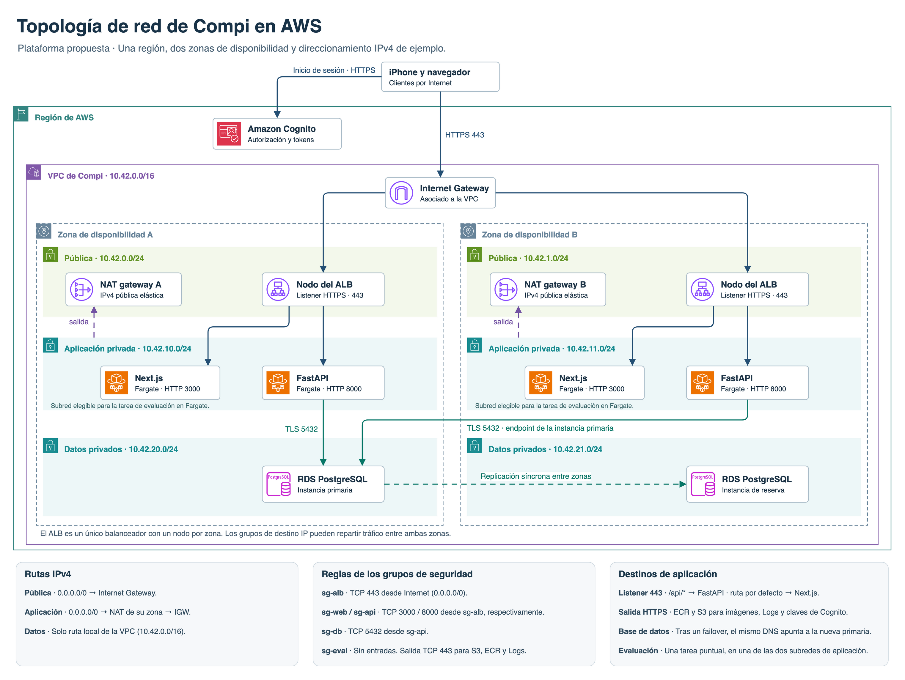
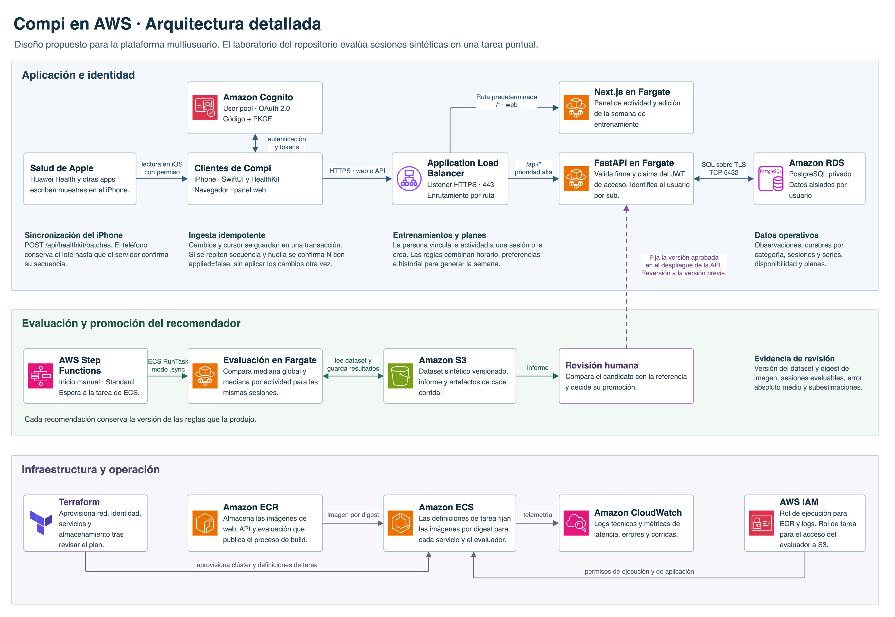

# Arquitectura de Compi en AWS

Las dos vistas describen la plataforma propuesta para llevar Compi del Mac a un servicio por usuario. La primera sigue el tráfico por la red. La segunda sigue un lote de Salud, una consulta del panel y la promoción de una versión del recomendador. Hoy la instalación personal guarda los datos en el Mac. [Arquitectura local](arquitectura.md) · [Laboratorio sintético del repositorio](#laboratorio-sintético-del-repositorio)

## Red de la plataforma propuesta

[Ampliar la topología de red](diagramas/aws-red.png) · [Editar la red en draw.io](diagramas/aws-red.drawio)

Un único balanceador público termina TLS en el puerto 443 con un certificado de ACM. La regla `/api/*` dirige las llamadas al grupo de destinos IP de FastAPI en el puerto 8000. La regla predeterminada dirige las páginas al grupo de Next.js en el 3000. Los destinos reciben HTTP privado desde el grupo de seguridad del balanceador. [Balanceo para tareas ECS](https://docs.aws.amazon.com/AmazonECS/latest/developerguide/alb.html) · [Nodos del ALB por zona](https://docs.aws.amazon.com/elasticloadbalancing/latest/application/application-load-balancers.html)

Para esta propuesta se eligieron dos zonas de disponibilidad, un NAT público zonal en cada una y subredes privadas de aplicación y de datos. La ruta de salida de cada subred de aplicación apunta al NAT de su zona. La API abre la conexión TLS al endpoint de RDS PostgreSQL en el puerto 5432. RDS replica los cambios de forma síncrona a la instancia de reserva en la otra zona y se encarga de la conmutación. [NAT zonal](https://docs.aws.amazon.com/vpc/latest/userguide/nat-gateway-basics.html) · [Instancia RDS Multi-AZ con reserva](https://docs.aws.amazon.com/AmazonRDS/latest/UserGuide/Concepts.MultiAZSingleStandby.html)

## Arquitectura detallada del producto y MLOps

[Ampliar la arquitectura detallada](diagramas/aws-detallada.png) · [Editar la arquitectura en draw.io](diagramas/aws-detallada.drawio)

La infraestructura de esta plataforma se definirá en **Terraform**. En el flujo propuesto, el equipo revisa el plan y aplica los cambios aprobados. La imagen se publica en ECR por separado y la definición de tarea fija el digest que usará Fargate. Los módulos Terraform de la plataforma están pendientes de implementación.

**Acceso e ingestión.** Hoy el iPhone admite destinos locales y usa un token compartido. El receptor móvil y la API del panel son procesos distintos. Para el modo nube habría que admitir el dominio HTTPS en iOS, integrar la ruta de lotes en la API del producto y validar allí el token de acceso emitido por Cognito. El cliente iOS usaría el flujo de código de autorización con PKCE. La API derivaría el usuario del token y aislaría observaciones, cursores, entrenamientos y planes en cada consulta. El reenvío del mismo lote conservaría su garantía por usuario y categoría. Antes del primer piloto se probaría el aislamiento con dos cuentas, permisos parciales, revocación, borrado y restauración. [Cliente actual](../ios/Compi/Connection.swift) · [Autorización en Cognito](https://docs.aws.amazon.com/cognito/latest/developerguide/authorization-endpoint.html) · [Verificación del token](https://docs.aws.amazon.com/cognito/latest/developerguide/amazon-cognito-user-pools-using-tokens-verifying-a-jwt.html)

**Datos y modelos.** RDS conservaría el historial operativo. Para el primer ensayo, S3 recibiría un conjunto sintético versionado. Usar observaciones personales exigiría una exportación explícita para la finalidad autorizada, minimización de campos, cifrado, acceso por rol y un plazo de retención que cubra también versiones anteriores y derivados. Un flujo manual de Step Functions lanzaría la evaluación en Fargate. El informe vincularía versión del dataset, digest de imagen, versión candidata, error en minutos, subestimaciones y número de sesiones evaluables. [Integración de Step Functions con ECS](https://docs.aws.amazon.com/step-functions/latest/dg/connect-ecs.html) · [Versionado en S3](https://docs.aws.amazon.com/AmazonS3/latest/userguide/Versioning.html)

**Promoción y recuperación.** Las reglas actuales serían la primera versión desplegada. La promoción requeriría revisar el candidato frente a la referencia sobre el mismo período y acordar qué mejora compensa el cambio. El despliegue de la API fijaría la versión aprobada y cada recomendación guardaría qué versión la produjo. Volver a la versión anterior permitiría revertir una degradación sin reentrenar. MLflow ya admite métricas agregadas en el laboratorio local como opción de seguimiento. Un servicio compartido de tracking tendría sentido cuando varias personas necesiten comparar corridas. [Planificador actual](../backend/app/services/week_service.py) · [Seguimiento local](operacion-local.md#evaluar-la-duración)

## Laboratorio sintético del repositorio

El laboratorio permite comparar dos estimaciones de duración sobre las mismas sesiones sintéticas. El prototipo documentado en el repositorio usa CloudFormation y una tarea puntual en una subred existente. Los diagramas siguientes conservan el contexto del prototipo y del diseño inicial. [Diagrama del laboratorio](diagramas/aws-laboratorio.png) · [Fuente editable](diagramas/aws-laboratorio.drawio) · [Vista inicial del producto](diagramas/aws-mlops.drawio)

| Recurso o decisión | Qué ocurre al ejecutar el laboratorio |
|---|---|
| Infraestructura temporal | La plantilla define un clúster ECS, una definición de tarea, un rol de ejecución, un grupo de seguridad y un grupo de logs. Una llamada posterior a `RunTask` inicia el trabajo. La VPC, la subred y el repositorio ECR ya deben existir. |
| Red y permisos | La tarea usa IPv4 privada, sin reglas de entrada. El grupo de seguridad permite salida TCP 443 a cualquier IPv4. Para acceder a ECR y a los logs necesita conectividad existente mediante NAT o endpoints de ECR API, ECR DKR, S3 para las capas y CloudWatch Logs. El agente de Fargate usa el **rol de ejecución** para descargar la imagen y entregar los logs. El contenedor carece de rol de tarea. |
| Cómputo y datos | La imagen Linux x86_64 se fija por digest. La tarea usa 0,25 vCPU y 512 MiB para ejecutar `python -m app.experiment --synthetic`. Genera las sesiones en memoria y compara dos medianas sobre las mismas fechas. |
| Resultado y reintentos | `run.sh` pasa un identificador de ejecución a ECS, espera a que la tarea se detenga, verifica el código de salida y recupera el informe sintético. Guardar el JSON junto al digest de imagen permite asociar código, huella del conjunto y resultados. Para repetir una solicitud interrumpida se conserva el mismo identificador y los mismos parámetros durante la ventana de idempotencia de ECS. |

En la comprobación **local** del comando definido para Fargate se generaron 18 sesiones. Nueve cumplieron el mínimo de historial para evaluar ambas alternativas. El error absoluto medio fue de **10,61 min** con la mediana general y **1,44 min** con la mediana por actividad. Son resultados reproducibles del ejemplo sintético. La precisión para una persona y el tiempo y costo de ejecución en AWS necesitan mediciones propias. [Experimento](../backend/app/experiment.py) · [Plantilla](../infra/aws/template.json) · [Ejecución y cierre](../infra/aws/README.md) · [Rol de ejecución en ECS](https://docs.aws.amazon.com/AmazonECS/latest/developerguide/task_execution_IAM_role.html)

## Operación y criterio para avanzar

| Pregunta | Qué medir o comprobar |
|---|---|
| ¿Se reproduce el experimento en AWS? | Misma huella de dataset, digest de imagen y métricas que la referencia local. Separar el tiempo de desplegar la pila, iniciar la tarea y ejecutar la evaluación. |
| ¿Cuánto cuesta cada ensayo? | Sumar cómputo Fargate, logs, ECR y la parte atribuible de la red. Guardar el informe antes de desmontar. Al eliminar la pila se elimina el grupo de logs. La imagen y la red siguen su propio ciclo de vida. El presupuesto orientativo de USD 25 se contrasta con cargos reales. |
| ¿Funciona el servicio para el usuario? | En el piloto, instrumentar con OpenTelemetry la latencia p95 y errores de ingestión, conflictos de secuencia, tiempo desde recepción hasta disponibilidad en el panel y fallos del trabajo de evaluación. Centralizar métricas y alarmas en CloudWatch y muestrear trazas sin muestras de Salud, tokens ni identificadores personales. |
| ¿Qué se despliega con cada cambio? | Los cambios de infraestructura, la publicación de la imagen y la promoción del recomendador tendrían flujos independientes. Para probarlos, repetir una evaluación con la misma imagen y recuperar la versión previa. |

Para contrastar la evaluación local con una corrida en AWS se necesitan el informe, el digest de imagen, la duración y el costo observado. El ALB, los NAT zonales, los servicios continuos y RDS Multi-AZ corresponden al presupuesto de la plataforma propuesta. [Procedimiento del prototipo](../infra/aws/README.md) · [Precios de Fargate](https://aws.amazon.com/fargate/pricing/)
