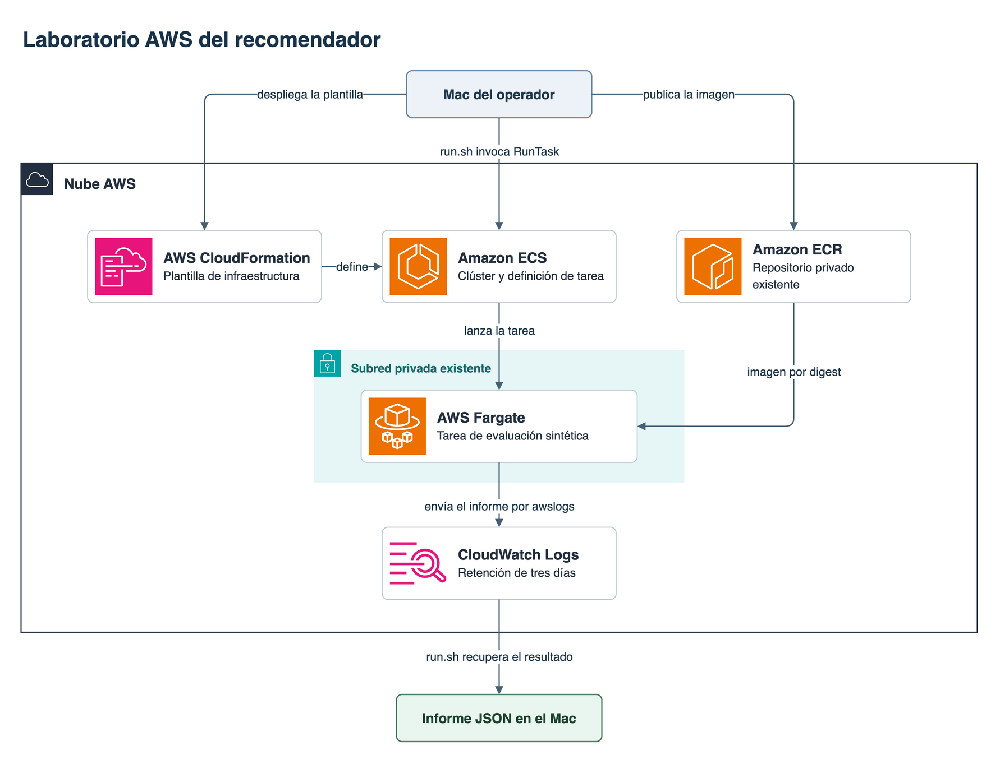
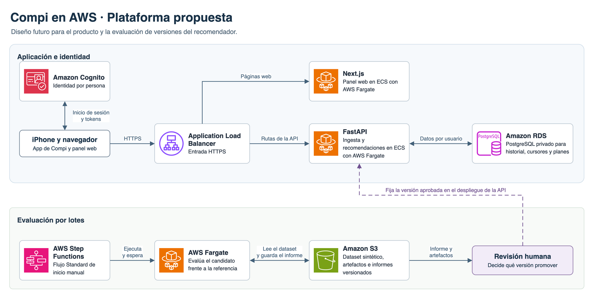

# Arquitectura de Compi en AWS

¿Mejora la estimación de duración si comparamos una sesión con las anteriores de la misma actividad? El repositorio define un laboratorio AWS por lotes que genera datos sintéticos para responder esa pregunta. Salud, las credenciales del iPhone y PostgreSQL personal permanecen en la instalación local. La segunda vista propone cómo ofrecer el producto a varias personas si se decide operar un servicio en nube. La validación de esta guía se hizo localmente, sobre la plantilla, el lanzador y el experimento.

## Laboratorio definido en CloudFormation

[Diagrama editable del laboratorio en draw.io](diagramas/aws-laboratorio.drawio) · [Ampliar imagen](diagramas/aws-laboratorio.png)

| Recurso o decisión | Qué ocurre al ejecutar el laboratorio |
|---|---|
| Infraestructura temporal | La plantilla define un clúster ECS, una definición de tarea, un rol de ejecución, un grupo de seguridad y un grupo de logs. Una llamada posterior a `RunTask` inicia el trabajo. La VPC, la subred y el repositorio ECR ya deben existir. |
| Red y permisos | La tarea usa IPv4 privada, sin reglas de entrada. El grupo de seguridad permite salida TCP 443 a cualquier IPv4. Para acceder a ECR y a los logs necesita conectividad existente mediante NAT o endpoints de ECR API, ECR DKR, S3 para las capas y CloudWatch Logs. El agente de Fargate usa el **rol de ejecución** para descargar la imagen y entregar los logs. El contenedor carece de rol de tarea. |
| Cómputo y datos | La imagen Linux x86_64 se fija por digest. La tarea usa 0,25 vCPU y 512 MiB para ejecutar `python -m app.experiment --synthetic`. Genera las sesiones en memoria y compara dos medianas sobre las mismas fechas. |
| Resultado y reintentos | `run.sh` pasa un identificador de ejecución a ECS, espera a que la tarea se detenga, verifica el código de salida y recupera el informe sintético. Guardar el JSON junto al digest de imagen permite asociar código, huella del conjunto y resultados. Para repetir una solicitud interrumpida se conserva el mismo identificador y los mismos parámetros durante la ventana de idempotencia de ECS. |

En la comprobación **local** del comando definido para Fargate se generaron 18 sesiones. Nueve cumplieron el mínimo de historial para evaluar ambas alternativas. El error absoluto medio fue de **10,61 min** con la mediana general y **1,44 min** con la mediana por actividad. Son resultados reproducibles del ejemplo sintético. La precisión para una persona y el tiempo y costo de ejecución en AWS necesitan mediciones propias. [Experimento](../backend/app/experiment.py) · [Plantilla](../infra/aws/template.json) · [Ejecución y cierre](../infra/aws/README.md) · [Rol de ejecución en ECS](https://docs.aws.amazon.com/AmazonECS/latest/developerguide/task_execution_IAM_role.html)

## Plataforma de producto y MLOps propuesta

Esta vista es un diseño futuro. Conserva el cliente Swift, el panel Next.js y la API FastAPI. Introduce identidad por persona, una base operativa privada y un proceso independiente para evaluar versiones del recomendador. Los componentes de esta vista requieren implementación y pruebas antes de admitir datos personales.

[Diagrama editable de la plataforma propuesta en draw.io](diagramas/aws-mlops.drawio) · [Ampliar imagen](diagramas/aws-mlops.png)

**Red del producto.** El ALB sería el único punto de entrada de la aplicación, con certificado público y rutas para la web y la API. Los dos servicios Fargate vivirían en subredes privadas y aceptarían tráfico del balanceador. Solo la API y los trabajos expresamente autorizados podrían acceder a RDS. Esta distribución conserva el servidor Next.js y los módulos Python que ya tiene Compi. [Balanceo de aplicaciones en ECS](https://docs.aws.amazon.com/AmazonECS/latest/developerguide/alb.html)

**Acceso e ingestión.** El receptor actual del iPhone admite destinos locales y usa un token compartido. Un modo nube explícito necesitaría un dominio HTTPS, autenticación en Cognito con código de autorización y PKCE para iOS, y verificación del token de acceso por la API. La API derivaría el usuario del token y aislaría observaciones, cursores, entrenamientos y planes en cada consulta. El reenvío del mismo lote conservaría su garantía por usuario y categoría. Antes del primer piloto se probaría el aislamiento con dos cuentas, permisos parciales, revocación, borrado y restauración. [Cliente actual](../ios/Compi/Connection.swift) · [Autorización en Cognito](https://docs.aws.amazon.com/cognito/latest/developerguide/authorization-endpoint.html) · [Verificación del token](https://docs.aws.amazon.com/cognito/latest/developerguide/amazon-cognito-user-pools-using-tokens-verifying-a-jwt.html)

**Datos y modelos.** RDS conservaría el historial operativo. Para el primer ensayo, S3 recibiría un conjunto sintético versionado. Usar observaciones personales exigiría una exportación explícita para la finalidad autorizada, minimización de campos, cifrado, acceso por rol y un plazo de retención que cubra también versiones anteriores y derivados. Un flujo manual de Step Functions lanzaría la evaluación en Fargate. El informe vincularía versión del dataset, digest de imagen, versión candidata, error en minutos, subestimaciones y número de sesiones evaluables. [Integración de Step Functions con ECS](https://docs.aws.amazon.com/step-functions/latest/dg/connect-ecs.html) · [Versionado en S3](https://docs.aws.amazon.com/AmazonS3/latest/userguide/Versioning.html)

**Promoción y recuperación.** Las reglas actuales serían la primera versión desplegada. La promoción requeriría revisar el candidato frente a la referencia sobre el mismo período y acordar qué mejora compensa el cambio. El despliegue de la API fijaría la versión aprobada y cada recomendación guardaría qué versión la produjo. Volver a la versión anterior permitiría revertir una degradación sin reentrenar. MLflow ya admite métricas agregadas en el laboratorio local como opción de seguimiento. Un servicio compartido de tracking tendría sentido cuando varias personas necesiten comparar corridas. [Planificador actual](../backend/app/services/week_service.py) · [Seguimiento local](operacion-local.md#evaluar-la-duración)

## Operación y criterio para avanzar

| Pregunta | Qué medir o comprobar |
|---|---|
| ¿Se reproduce el experimento en AWS? | Misma huella de dataset, digest de imagen y métricas que la referencia local. Separar el tiempo de desplegar la pila, iniciar la tarea y ejecutar la evaluación. |
| ¿Cuánto cuesta cada ensayo? | Sumar cómputo Fargate, logs, ECR y la parte atribuible de la red. Guardar el informe antes de desmontar. Al eliminar la pila se elimina el grupo de logs. La imagen y la red siguen su propio ciclo de vida. El presupuesto orientativo de USD 25 se contrasta con cargos reales. |
| ¿Funciona el servicio para el usuario? | En el piloto, instrumentar con OpenTelemetry la latencia p95 y errores de ingestión, conflictos de secuencia, tiempo desde recepción hasta disponibilidad en el panel y fallos del trabajo de evaluación. Centralizar métricas y alarmas en CloudWatch y muestrear trazas sin muestras de Salud, tokens ni identificadores personales. |
| ¿Qué se despliega con cada cambio? | Los cambios de infraestructura, la publicación de la imagen y la promoción del recomendador tendrían flujos independientes. Para probarlos, repetir una evaluación con la misma imagen y recuperar la versión previa. |

**El siguiente hito en AWS** es ejecutar una vez el experimento definido en la plantilla, conservar el informe y el digest, y documentar duración y costo. El ALB, los servicios continuos y RDS del diseño futuro tienen su propio presupuesto. [Procedimiento del laboratorio](../infra/aws/README.md) · [Precios de Fargate](https://aws.amazon.com/fargate/pricing/)
