# Arquitectura de Compi

Compi ayuda a decidir qué entrenar durante el tiempo disponible. El primer usuario combina fuerza en gimnasio, caminatas y carrera al aire libre. El peso corporal, los kilos de una serie y los minutos disponibles representan tres medidas distintas. Los objetivos de composición corporal y respiración orientan el producto; hoy la evidencia para recomendar procede del historial de sesiones, las series registradas y el horario declarado.

## Recorrido de los datos

```mermaid
flowchart LR
    W[Reloj Huawei] --> H[Huawei Health]
    H -->|categorías compartidas| A[Salud de Apple]
    P[Fuentes del iPhone] --> A
    A -->|HealthKit y permiso de lectura| I[Compi SwiftUI]
    I -->|lote HTTPS por Wi-Fi| R[Receptor FastAPI]
    R --> O[(Observaciones y cursores)]
    O --> E[Evaluación temporal de duración]
    O -->|selección confirmada en el panel| T
    E --> D[Panel local Next.js]
    D -->|horario, excepciones y series| B[API personal FastAPI]
    B --> T[(Sesiones y registros)]
    T --> M[Recomendador por reglas]
    M -->|sesiones y motivos| D
```

Los dos servicios FastAPI comparten modelos, migraciones y base PostgreSQL. El receptor móvil acepta una sola operación autenticada. Los planes, las consultas de salud y las operaciones de administración se atienden en el computador. El conector directo de Huawei es experimental y requiere autorización específica. Los datos de demostración usan una base independiente.

## Decisiones y evidencia

| Decisión | Razón | Cómo comprobarla |
|---|---|---|
| SwiftUI y HealthKit como entrada inicial | El historial del iPhone puede incluir datos escritos por Huawei y por otras apps. La disponibilidad varía según los permisos y el tipo de muestra. | Comparar categoría, aplicación de origen y hora en el iPhone físico con la recepción en el computador. |
| Monolito modular y PostgreSQL | Una transacción puede confirmar la página completa y el cursor conjuntamente. El iPhone y el panel se publican y actualizan por separado. | Cortar la red después del commit, reenviar y comprobar que el conteo se mantiene. |
| Conservar procedencia | El identificador de la aplicación que escribió la muestra permite seleccionar una fuente. Muestras parecidas de dos apps pueden describir un solo evento. | La evaluación utiliza exclusivamente la fuente seleccionada. No se suman sensores ni se deduce el dispositivo físico a partir del bundle. |
| Semanas editables y registro por serie | Una predicción necesita restricciones reales de tiempo y un resultado con el que compararse. | Cambiar una franja y revisar las sesiones pendientes, el motivo del cambio y el historial de las completadas. |
| Comparar contra una referencia sencilla | Con pocos datos personales es fácil confundir la memorización con una mejora. | Evaluar ambas alternativas en las mismas fechas y consultar los minutos de error y las subestimaciones. |

### Series de tiempo y observaciones

La frecuencia cardiaca y el peso se consultan como series temporales irregulares por fuente. La línea de tiempo del panel usa la hora de la medición y conserva cada punto observado. Sueño y entrenamiento se consultan por solape con el día elegido y conservan los extremos originales, incluso cuando cruzan la medianoche. El selector usa la zona local visible del navegador y la API recibe límites con zona. La disponibilidad semanal conserva por separado la zona horaria configurada para entrenar.

PostgreSQL conserva los tiempos en UTC y un índice por categoría e inicio. En un dispositivo compartiendo una única historia, este esquema permite consultar una ventana y contrastar el resultado directamente con Salud. Para evaluar otras bases o particiones mediríamos volumen, latencia de lectura por día y coste de almacenamiento. La hora de recepción del último lote sirve para vigilar la sincronización. Los intervalos sin datos siguen siendo huecos.

### Qué se guarda

| Registro | Identidad y significado |
|---|---|
| Observación | Categoría y UUID de muestra, bundle de origen, intervalo UTC y valor. FC en latidos/minuto, peso en kg, sueño en estados, entrenamiento en tipo y duración activa opcional. |
| Cursor | Por categoría se mantiene el stream emparejado, última secuencia confirmada, huella del lote y hora de recepción. Repetir el último lote es seguro; una secuencia divergente devuelve 409. |
| Sesión y series | El historial editable almacena ejercicios, repeticiones, peso, descanso y esfuerzo según los registra la persona. Los datos anteriores a la integración conservan su identidad. |
| Recomendación | La semana guarda sesión, horario, duración prevista, prescripción, motivos y cambios. Un registro realizado permite evaluar adherencia y error por separado. |
| Experimento | Versión de la evaluación, huella del conjunto, referencia, ventana histórica, número de sesiones evaluadas, error y subestimaciones. Las correcciones y borrados pueden cambiar la huella al repetirlo. |

Una categoría vacía indica que Compi carece de evidencia visible. Tampoco basta una variación de peso para calcular grasa o masa muscular. Una futura estimación personal debe identificar sus insumos, expresar su incertidumbre y permitir que el usuario la confirme o corrija.

## Operación, aprendizaje y costo

| Pregunta | Señal y uso |
|---|---|
| ¿Llegó la información? | Último lote y número de muestras por categoría en el panel privado. Revisar el permiso y la conectividad cuando haya un hueco. |
| ¿Se puede escribir? | Liveness en `/health`, conexión a la base en `/ready` y estado HTTP del lote. Los conflictos de secuencia requieren reconciliación. |
| ¿Dónde se pierde tiempo? | El receptor instrumenta con OpenTelemetry los lotes admitidos para validación: span, contador y duración. Primero medir latencia y errores a carga fija; dimensionar un tablero con p50/p95 y tasas al instalar un colector. La instrumentación evita payloads, credenciales e IDs de salud. |
| ¿Mejoró el despliegue? | Los workflows de backend, PWA e iOS corren por rutas. Usar su duración, fallos y tiempo de recuperación para comparar cambios de entrega, conservando la misma carga de pruebas. |
| ¿Mejoró el modelo? | Comparar MAE en minutos, conteo de subestimaciones y cobertura temporal. Exigir evaluación reproducible y revisión humana antes de cambiar la política que genera la semana. |
| ¿Qué aprendimos de un incidente? | Registrar impacto, cronología, dependencia que falló, evidencia que confirmó la causa, responsable de la mejora y prueba de recuperación. |

Los datos personales, copias y artefactos autorizados tienen políticas de retención propias. Reducir o seudonimizar un conjunto sigue exigiendo controlar el acceso. El primer [laboratorio AWS](../infra/aws/README.md) ejecuta solo el ejemplo sintético en una tarea temporal. Registrar imagen, tiempo de arranque, duración, errores y costo observado por ejecución. Revisar almacenamiento, red y logs que sigan facturando. El presupuesto orientativo de 25 USD para varios días se trata como hipótesis de planificación.

## Evolución y criterios de aceptación

1. **Validación física.** Emparejar el iPhone, probar permisos parciales, histórico inicial, pérdida de Wi-Fi, reenvío, corrección, borrado y restauración en una base aparte. Conservar solo el resultado de la prueba en documentación compartida.
2. **Validación de la conciliación.** En el panel, dos muestras que la persona identifica como la misma actividad pueden vincularse al mismo entrenamiento editable. El registro confirmado conserva su fecha, duración y series si la fuente cambia. Probar esta decisión con las apps concretas del iPhone antes de plantear sugerencias automáticas de coincidencias.
3. **MLOps.** Revisar resultados por actividad, sesgo hacia sesiones interrumpidas y tamaño de muestra. Definir el período de evaluación antes de elegir un candidato. Versionar artefacto, dependencias y conjunto autorizado. Registrar aceptación o rechazo y mantener una versión anterior recuperable.
4. **Plataforma.** Comparar colector OpenTelemetry con CloudWatch/X-Ray y un laboratorio Prometheus/Grafana sobre la misma carga. Infraestructura, publicación de la aplicación y promoción de modelos se aprueban por separado. Kubernetes es un ensayo posterior cuando exista una pregunta de orquestación, coste o recuperación. Bedrock se evaluará si se necesita explicar una decisión con lenguaje natural; la evidencia y los permisos siguen en la aplicación.
5. **Más personas.** Antes de aceptar una segunda cuenta, implementar identidad y aislamiento por usuario, consentimientos por finalidad, borrado de copias y derivados, evaluación entre usuarios y pruebas de autorización. La instalación personal usa una única identidad local.
