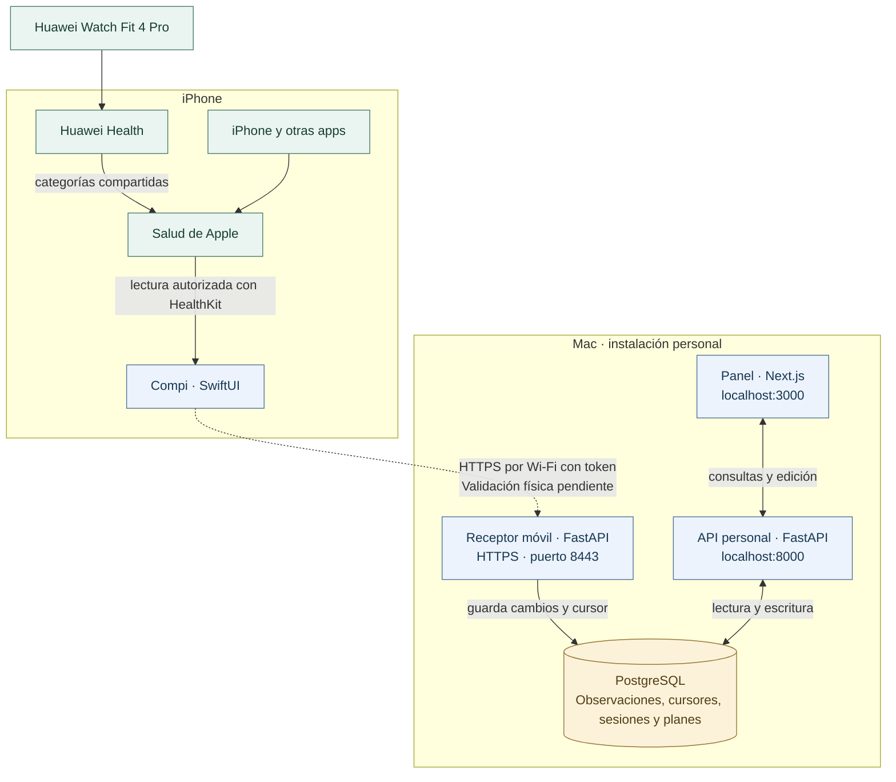
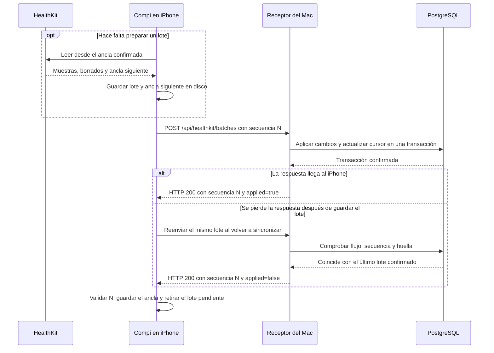

# Arquitectura de Compi

Compi ayuda a decidir qué entrenar durante el tiempo disponible. La primera versión combina fuerza en gimnasio, caminatas y carrera al aire libre. El iPhone recoge las categorías de Salud que autoriza la persona. En el Mac se conserva el historial y se genera la semana a partir de la disponibilidad, las preferencias y el entrenamiento registrado. La composición corporal y la respiración son objetivos personales para futuras evaluaciones.

## Recorrido de los datos

El diagrama muestra el recorrido implementado. El panel y su base se verificaron el 27 de noviembre de 2026. La línea discontinua marca el tramo pendiente de validar con la primera importación desde el iPhone físico. [Diagrama editable de draw.io](diagramas/arquitectura-local.drawio) · [Ver imagen](diagramas/arquitectura-local.png) · [Estado de la primera sincronización](operacion-local.md#estado-de-la-primera-sincronización)

El iPhone contacta al receptor por Wi-Fi. **Probar conexión** usa `GET /api/healthkit/connection` para comprobar el token, la versión del protocolo y el acceso al esquema antes de pedir permiso a Salud. **Sincronizar ahora** usa `POST /api/healthkit/batches` para enviar los cambios. El navegador del Mac usa la API personal para consultar el historial, confirmar actividades y editar la semana. Ambos procesos FastAPI comparten modelos, migraciones y la misma base personal. [Receptor móvil](../backend/app/mobile.py) · [API personal](../backend/app/main.py)

La app guarda la credencial de emparejamiento en el llavero del iPhone. En el Mac, el puerto de PostgreSQL se publica solo en loopback. La demo conserva sus ejemplos en una base independiente. El conector directo de Huawei es experimental y requiere autorización específica. Para el reloj del diagrama, Compi lee las muestras que Huawei Health comparte con Salud en el iPhone. [Credencial y transporte](../ios/Compi/Connection.swift) · [Red de PostgreSQL](../docker-compose.yml)

### Cómo llega una actividad al recomendador

Por ejemplo, una caminata compartida por Huawei aparece en el panel como observación con su fuente y su intervalo. En **Entrenamientos importados**, la persona puede crear una sesión editable o asociarla a una que ya registró. En un entrenamiento de fuerza puede añadir las series, repeticiones, kilos y descansos que realizó. Este paso evita contar dos veces una actividad que ya estaba registrada si se vincula a la sesión existente. [Conciliación de entrenamientos](../backend/app/routers/health_workouts.py)

El planificador por reglas combina horario semanal, excepciones, preferencias e historial de entrenamiento para proponer sesiones con duración y motivo. Por separado, el experimento de duración toma entrenamientos importados de una fuente y compara dos estimaciones con el tiempo que realmente transcurrió. Sus resultados se consultan en el panel. Adoptar una estimación para generar futuras semanas requiere una decisión posterior. [Generación de la semana](../backend/app/services/week_service.py) · [Evaluación temporal](../backend/app/services/duration_experiment.py)

## Decisiones y evidencia

| Decisión | Razón | Cómo comprobarla |
|---|---|---|
| SwiftUI y HealthKit como entrada inicial | El historial del iPhone puede incluir datos escritos por Huawei y por otras apps. La disponibilidad varía según los permisos y el tipo de muestra. | Comparar categoría, aplicación de origen y hora en el iPhone físico con la recepción en el computador. |
| Monolito modular y PostgreSQL | Una transacción puede confirmar la página completa y el cursor conjuntamente. El iPhone y el panel se publican y actualizan por separado. | Cortar la red después del commit, reenviar y comprobar que el conteo se mantiene. |
| Conservar procedencia | El identificador de la aplicación que escribió la muestra permite seleccionar una fuente. Muestras parecidas de dos apps pueden describir un solo evento. | La evaluación utiliza exclusivamente la fuente seleccionada. No se suman sensores ni se deduce el dispositivo físico a partir del bundle. |
| Semanas editables y registro por serie | Una predicción necesita restricciones reales de tiempo y un resultado con el que compararse. | Cambiar una franja y revisar las sesiones pendientes, el motivo del cambio y el historial de las completadas. |
| Comparar contra una referencia sencilla | Con pocos datos personales es fácil confundir la memorización con una mejora. | Evaluar ambas alternativas en las mismas fechas y consultar los minutos de error y las subestimaciones. |

### Series de tiempo y observaciones

La frecuencia cardiaca y el peso se consultan como series temporales irregulares por fuente. La línea de tiempo del panel usa la hora de la medición y conserva cada punto observado. Sueño y entrenamiento se consultan por solape con el día elegido y conservan los extremos originales, incluso cuando cruzan la medianoche. El selector usa la zona local visible del navegador y la API recibe límites con zona. La disponibilidad semanal conserva por separado la zona horaria configurada para entrenar.

PostgreSQL conserva los tiempos en UTC y un índice por categoría e inicio. En un dispositivo compartiendo una única historia, este esquema permite consultar una ventana y contrastar el resultado directamente con Salud. Para evaluar otras bases o particiones mediríamos volumen, latencia de lectura por día y coste de almacenamiento. La hora de recepción del último lote sirve para vigilar la sincronización. Los intervalos sin datos siguen siendo huecos.

### Qué se guarda

| Registro | Identidad y significado |
|---|---|
| Observación | Categoría y UUID de muestra, bundle de origen, intervalo UTC y valor. FC en latidos/minuto, peso en kg, sueño en estados, entrenamiento en tipo y duración activa opcional. |
| Cursor | Por categoría se mantiene el stream emparejado, última secuencia confirmada, huella del lote y hora de recepción. Repetir el último lote es seguro; una secuencia divergente devuelve 409. |
| Sesión y series | El historial editable almacena ejercicios, repeticiones, peso, descanso y esfuerzo según los registra la persona. Los datos anteriores a la integración conservan su identidad. |
| Recomendación | La semana guarda sesión, horario, duración prevista, prescripción, motivos y cambios. Un registro realizado permite evaluar adherencia y error por separado. |
| Experimento | Versión de la evaluación, huella del conjunto, referencia, ventana histórica, número de sesiones evaluadas, error y subestimaciones. Las correcciones y borrados pueden cambiar la huella al repetirlo. |

Una categoría vacía indica que Compi carece de evidencia visible. Tampoco basta una variación de peso para calcular grasa o masa muscular. Una futura estimación personal debe identificar sus insumos, expresar su incertidumbre y permitir que el usuario la confirme o corrija.

## Sincronización de un lote

**Sincronizar ahora** solicita lectura de las categorías elegidas. El diagrama sigue una categoría con cambios. El ancla indica hasta dónde leyó el iPhone en Salud. El cursor de PostgreSQL identifica el último lote confirmado de esa categoría. [Diagrama editable de draw.io](diagramas/sincronizacion.drawio) · [Ver imagen](diagramas/sincronizacion.png)

Un conflicto de flujo, secuencia o contenido devuelve HTTP 409. Si el almacenamiento está indisponible, el receptor devuelve HTTP 503. En ambos casos el iPhone conserva el lote y su posición anterior. Una página de Salud sin cambios visibles termina la lectura de esa categoría. [Estado local del iPhone](../ios/Compi/SyncData.swift) · [Bucle de sincronización](../ios/Compi/CompiApp.swift) · [Transacción del receptor](../backend/app/services/healthkit.py) · [Guía de recuperación](operacion-local.md#comprobar-y-recuperar)

## Operación, aprendizaje y costo

La [arquitectura AWS](arquitectura-aws.md) muestra los recursos del laboratorio sintético por lotes y el diseño propuesto para operar el producto y evaluar modelos en la nube.

| Pregunta | Señal y uso |
|---|---|
| ¿Llegó la información? | Último lote y número de muestras por categoría en el panel privado. Revisar el permiso y la conectividad cuando haya un hueco. |
| ¿Se puede escribir? | Liveness en `/health`, conexión a la base en `/ready` y estado HTTP del lote. Los conflictos de secuencia requieren reconciliación. |
| ¿Dónde se pierde tiempo? | El receptor instrumenta con OpenTelemetry los lotes admitidos para validación: span, contador y duración. Primero medir latencia y errores a carga fija; dimensionar un tablero con p50/p95 y tasas al instalar un colector. La instrumentación evita payloads, credenciales e IDs de salud. |
| ¿Mejoró el despliegue? | Los workflows de backend, PWA e iOS corren por rutas. Usar su duración, fallos y tiempo de recuperación para comparar cambios de entrega, conservando la misma carga de pruebas. |
| ¿Mejoró el modelo? | Comparar MAE en minutos, conteo de subestimaciones y cobertura temporal. Exigir evaluación reproducible y revisión humana antes de cambiar la política que genera la semana. |
| ¿Qué aprendimos de un incidente? | Registrar impacto, cronología, dependencia que falló, evidencia que confirmó la causa, responsable de la mejora y prueba de recuperación. |

Los datos personales, copias y artefactos autorizados tienen políticas de retención propias. Reducir o seudonimizar un conjunto sigue exigiendo controlar el acceso. El primer [laboratorio AWS](../infra/aws/README.md) ejecuta solo el ejemplo sintético en una tarea temporal. Registrar imagen, tiempo de arranque, duración, errores y costo observado por ejecución. Revisar almacenamiento, red y logs que sigan facturando. El presupuesto orientativo de 25 USD para varios días se trata como hipótesis de planificación.

## Evolución y criterios de aceptación

1. **Validación física.** Emparejar el iPhone, probar permisos parciales, histórico inicial, pérdida de Wi-Fi, reenvío, corrección, borrado y restauración en una base aparte. Conservar solo el resultado de la prueba en documentación compartida.
2. **Validación de la conciliación.** En el panel, dos muestras que la persona identifica como la misma actividad pueden vincularse al mismo entrenamiento editable. El registro confirmado conserva su fecha, duración y series si la fuente cambia. Probar esta decisión con las apps concretas del iPhone antes de plantear sugerencias automáticas de coincidencias.
3. **MLOps.** Revisar resultados por actividad, sesgo hacia sesiones interrumpidas y tamaño de muestra. Definir el período de evaluación antes de elegir un candidato. Versionar artefacto, dependencias y conjunto autorizado. Registrar aceptación o rechazo y mantener una versión anterior recuperable.
4. **Plataforma.** Comparar colector OpenTelemetry con CloudWatch/X-Ray y un laboratorio Prometheus/Grafana sobre la misma carga. Infraestructura, publicación de la aplicación y promoción de modelos se aprueban por separado. Kubernetes es un ensayo posterior cuando exista una pregunta de orquestación, coste o recuperación. Bedrock se evaluará si se necesita explicar una decisión con lenguaje natural; la evidencia y los permisos siguen en la aplicación.
5. **Más personas.** Antes de aceptar una segunda cuenta, implementar identidad y aislamiento por usuario, consentimientos por finalidad, borrado de copias y derivados, evaluación entre usuarios y pruebas de autorización. La instalación personal usa una única identidad local.
